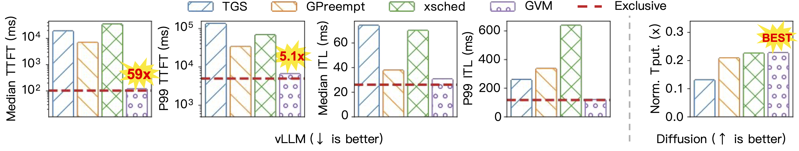

# GVM

GVM is an OS-level GPU virtualization layer which achieves hardware-like performance isolation while preserving the flexibility of software-based sharing
GVM provides cgroup-like APIs for GPU applications so you can check and operate GPU applications like what you did on CPU applications.
For details, please check [here](https://github.com/ovg-project/GVM/blob/main/assets/GVM_paper.pdf).

| API                 | Description                                                                                |
| :------------------ | :----------------------------------------------------------------------------------------- |
| memory.limit        | Check or set the maximum amount of memory that the application can allocate on GPU         |
| memory.current      | Get the current memory usage of the application on GPU                                     |
| memory.swap.current | Get the current amount of memory swapped to host of the application on GPU                 |
| compute.priority    | Get or set the compute priority of the application on GPU (0-15. lower is higher priority) |
| compute.freeze      | Freeze or unfreeze the application on GPU                                                  |
| gcgroup.stat        | Get statistics about the application                                                       |

## Performance

The figure shows the performance benefits of GVM when colocating high priority task `vllm` and low priority task `diffusion` on A100-40G GPU.
GVM can achieve **59x** better p99 TTFT in high priority task compared to second best baseline while still get the highert throughput on low priority task.
Thanks to [@boyuan](https://github.com/boyuanjia1126) for decorating figure.


# Requirements

1. [GVM NVIDIA GPU Driver](https://github.com/ovg-project/gvm-nvidia-driver-modules) installed
2. [GVM CUDA Driver Intercept Layer](https://github.com/ovg-project/gvm-cuda-driver) installed
3. Dependencies:
   1. `python3` `python3-pip` `python3-venv`
   2. `gcc` `g++` `make` `cmake`
   3. `cuda-toolkit` `nvidia-open`

# Install applications

```
./setup {llama.cpp|diffusion|llamafactory|vllm|sglang}
```

# Example

## diffuser

Launch your diffuser:

```
source diffuser/bin/activate
export LD_LIBRARY_PATH=<GVM Intercept Layer install dir>:$LD_LIBRARY_PATH
python3 diffuser/diffusion.py --dataset_path=diffuser/vidprom.txt --log_file=diffuser/stats.txt
```

Get pid of diffuser:

```
export pid=<pid of diffuser showed on nvidia-smi>
```

Check kernel submission stats:

```
cat /sys/kernel/debug/nvidia-uvm/processes/$pid/0/gcgroup.stat
```

Check memory stats:

```
cat /sys/kernel/debug/nvidia-uvm/processes/$pid/0/memory.current
cat /sys/kernel/debug/nvidia-uvm/processes/$pid/0/memory.swap.current
```

Limit memory usage:

```
echo <memory limit in bytes> | sudo tee /sys/kernel/debug/nvidia-uvm/processes/$pid/0/memory.limit
```

## vllm + diffuser

Launch your vllm:

```
source vllm/bin/activate
export LD_LIBRARY_PATH=<GVM Intercept Layer install dir>:$LD_LIBRARY_PATH
vllm serve meta-llama/Llama-3.2-3B --gpu-memory-utilization 0.8 --disable-log-requests --enforce-eager
```

Launch your diffuser:

```
source diffuser/bin/activate
export LD_LIBRARY_PATH=<GVM Intercept Layer install dir>:$LD_LIBRARY_PATH
python3 diffuser/diffusion.py --dataset_path=diffuser/vidprom.txt --log_file=diffuser/stats.txt
```

Get pid of diffuser and vllm:

```
export diffuserpid=<pid of diffuser showed on nvidia-smi>
export vllmpid=<pid of vllm showed on nvidia-smi>
```

Check compute priority of vllm:

```
cat /sys/kernel/debug/nvidia-uvm/processes/$vllmpid/0/compute.priority
```

Set compute priority of vllm to 2 to use a larger timeslice:

```
echo 2 | sudo tee /sys/kernel/debug/nvidia-uvm/processes/$vllmpid/0/compute.priority
```

Limit memory usage of diffuser to ~6GB to make enough room for vllm to run:

```
echo 6000000000 | sudo tee /sys/kernel/debug/nvidia-uvm/processes/$diffuserpid/0/memory.limit
```

Generate workloads for vllm:

```
source vllm/bin/activate
vllm bench serve \
    --model meta-llama/Llama-3.2-3B \
    --dataset-name random \
    --random-input-len 256 \
    --random-output-len 256 \
    --num-prompts 512 \
    --request-rate 32
```

Preempt diffuser for even higher vllm performance:

```
echo 1 | sudo tee /sys/kernel/debug/nvidia-uvm/processes/$diffuserpid/0/compute.freeze
```

After vllm workloads stop, reschedule diffuser:

```
echo 0 | sudo tee /sys/kernel/debug/nvidia-uvm/processes/$diffuserpid/0/compute.freeze
```

# Troubleshooting

This section documents common issues encountered during GVM setup and their solutions.

## Issue 1: Git submodules fail to clone (SSH authentication)

**Error:**

```
git@github.com: Permission denied (publickey).
fatal: Could not read from remote repository.
```

**Cause:** Submodule URLs use SSH (`git@github.com:...`) but SSH keys are not configured.

**Fix:** Override submodule URLs to use HTTPS before initializing:

```bash
git config submodule.gvm-cuda-driver.url https://github.com/ovg-project/gvm-cuda-driver.git
git config submodule.gvm-nvidia-driver-modules.url https://github.com/ovg-project/gvm-nvidia-driver-modules.git
git submodule update --init --recursive
```

---

## Issue 2: CUDA installation fails on kernel 6.8+

**Error:**

```
nvidia/nv-dmabuf.c:844:9: error: implicit declaration of function 'dma_buf_attachment_is_dynamic'
ERROR: The nvidia kernel module was not created.
```

**Cause:** The driver bundled with CUDA (575.57.08) is incompatible with kernels >= 6.8 due to removed kernel APIs.

**Fix:** Install CUDA toolkit only (without bundled driver), then install GVM driver separately:

```bash
# In gvm-nvidia-driver-modules/scripts/
sudo sh cuda_12.9.1_575.57.08_linux.run --silent --toolkit --override --no-drm
sudo sh NVIDIA-Linux-x86_64-575.64.05.run --no-kernel-modules
```

When prompted for kernel module type, select **MIT/GPL (option 2)**.

---

## Issue 3: Kernel module compilation fails on kernel 6.17+

**Error:**

```
nvidia-drm/nvidia-drm-fb.c:308:5: error: too few arguments to function 'drm_helper_mode_fill_fb_struct'
nvidia-drm/nvidia-drm-drv.c:240:18: error: initialization from incompatible pointer type
```

**Cause:** GVM kernel modules (based on NVIDIA 575.64.05) are incompatible with kernel 6.17+ due to DRM API changes.

**Fix:** Downgrade to kernel 6.8 (tested with 6.8.0-1007-gcp on Ubuntu 24.04):

```bash
sudo apt-get install -y linux-image-6.8.0-1007-gcp linux-headers-6.8.0-1007-gcp linux-modules-6.8.0-1007-gcp
```

On GCP cloud images, you may need to manually set the boot kernel in `/etc/default/grub.d/50-cloudimg-settings.cfg`:

```bash
# Find the kernel entry ID
sudo grep -E "menuentry|submenu" /boot/grub/grub.cfg | head -20

# Update GRUB_DEFAULT (replace <UUID> with actual UUID from above)
sudo sed -i "s|GRUB_DEFAULT=0|GRUB_DEFAULT='gnulinux-advanced-<UUID>>gnulinux-6.8.0-1007-gcp-advanced-<UUID>'|" /etc/default/grub.d/50-cloudimg-settings.cfg

sudo update-grub && sudo reboot
```

Verify after reboot:

```bash
uname -r  # should show 6.8.0-1007-gcp
```

---

## Issue 4: `nvcc` not found during CUDA intercept layer build

**Error:**

```
/bin/sh: 1: nvcc: not found
make: *** [Makefile:30: build] Error 127
```

**Cause:** CUDA toolkit installs `nvcc` to `/usr/local/cuda/bin/` which is not in `$PATH` by default.

**Fix:**

```bash
export PATH=/usr/local/cuda/bin:$PATH
```

Add this to your `~/.bashrc` to make it permanent:

```bash
echo 'export PATH=/usr/local/cuda/bin:$PATH' >> ~/.bashrc
```

---

## Issue 5: HuggingFace gated model access denied

**Error:**

```
huggingface_hub.errors.GatedRepoError: 401 Client Error.
Access to model stabilityai/stable-diffusion-3.5-medium is restricted.
```

**Cause:** Some models (like `stabilityai/stable-diffusion-3.5-medium`) require HuggingFace authentication and license acceptance.

**Fix:**

1. Accept the license at https://huggingface.co/stabilityai/stable-diffusion-3.5-medium
2. Generate a token at https://huggingface.co/settings/tokens (select "Read" access)
3. Authenticate on your system:

```bash
python3 -c "from huggingface_hub import login; login(token='<YOUR_HF_TOKEN>')"
```

---

## Issue 6: Diffusion log file fails to save

**Error:**

```
FileNotFoundError: [Errno 2] No such file or directory: 'diffusion_outputs/diffusion/stats.txt'
```

**Cause:** The diffusion script writes logs to `diffusion_outputs/<log_file>` but doesn't create the directory automatically.

**Fix:** Create the directory before running:

```bash
mkdir -p diffusion_outputs/diffusion
```

**Note:** Use `--num_requests=5` to run a quick smoke test (default is 10,000 requests which takes ~40 hours).

---

## Additional Notes

- **Tested environment:** GCP VM with Ubuntu 24.04.4 LTS, kernel 6.8.0-1007-gcp, NVIDIA L4 GPU
- **After reboot:** If GVM modules are not loaded, run `sudo ./deploy_modules.sh` from `~/GVM/gvm-nvidia-driver-modules/scripts/`
- **Before running GPU apps:** Always set `export LD_LIBRARY_PATH=~/GVM/gvm-cuda-driver/install:$LD_LIBRARY_PATH`
